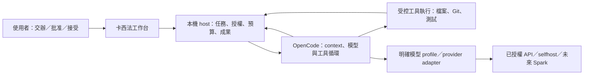

# 卡西法：產品方向與第一版工作流程提案

日期：2026-10-26（Asia/Taipei）。本文件是研究提案，**不是正式 UI 或下一階段開發授權**。已確認的約束維持：OpenCode 主選、Pi 對照、明確模型設定檔、不做自動路由；40 次生成上限已批准，但服務恢復與實測窗口另行確認。

## 建議方向

**把卡西法定位為個人 coding-agent 任務與成果工作台：交辦後可以離開，回來能知道做到哪、為何停、交出了什麼，以及如何安全接續。**

第一版最值得解決的是從「一段對話」到「一件有完成條件、權限範圍與可核對成果的工作」。建議在 OpenCode 外建立小範圍的任務管理與交付層，沿用其模型／工具循環；不先重做 IDE、終端或模型服務。若上游 UI 加設定已足夠滿足這個流程，就保留更薄的整合，不為自製 UI 而擴張。

這個價值仍是待驗證假設。35/35 離線通過只證明特定 SDK／mock 邊界；沒有證明使用者更省心、任務更快完成，或任何 harness／模型普遍勝出。

## 為何可能值得做，以及何時不值得

| 現有工作中的成本 | 卡西法要提供的可觀察成果 | 第一版如何判定有用 |
|---|---|---|
| 隔天回來要重讀長對話，才能分清完成、卡住、未知 | 每個任務有一份目前狀態與成果摘要，附原始證據入口 | 不讀完整時間線也能指出下一個必要動作 |
| 不同模型／工具的授權與工作規則分散 | 任務固定 profile、資料／工具範圍、完成條件及預算 | 換端點不會默默增加權限、付費或漏掉必要驗證 |
| agent 說完成，但不知道驗過什麼 | diff、驗證命令、結果、未決項目綁定同一工作版本 | 可以直接做接受／退回決定，而非再問一次狀態 |
| 中斷後不知道再按一次會不會重做 | 保留 request／operation 身分與 UNKNOWN 狀態，先核對再接續 | 重新開啟工作不會直接觸發未知請求重送 |

上游工具本來就有 session、權限及 UI 能力；以上是要驗證的完整使用流程，不是宣稱上游缺乏每個功能。若直接使用上游加設定已達同樣效果，卡西法應縮成設定、adapter 與成果格式。

## 三個選項

| 選項 | 優點 | 成本與限制 | 建議 |
|---|---|---|---|
| A. 上游工作台＋最小設定／plugin | 最少自行維護，最快開始實際工作 | 任務契約、跨 session 成果和 UNKNOWN 呈現是否足夠要實看 | 保留為最低成本基準與退路 |
| B. OpenCode 外的薄任務／成果工作台 | 可以集中交辦、批准、交付、恢復；推理與工具循環仍用上游 | 需維護少量 host、adapter、狀態映射；仍依賴上游事件語意 | **目前推薦，範圍待使用者確認** |
| C. 自製完整 IDE／自動多模型多代理平台 | 最大控制空間 | 沒有目前需求證明收益，容易把維護成本轉給自己 | 暫不做 |

Pi 是 B 的替代 harness，不必同時打造另一套完整產品。只有同品質實測、必要安全介面或維護工作量出現足以改變決策的差異，才重開選型。詳細的固定版本來源與風險見 [上游工作台研究](upstream-workbench-research-2026-10-26.md)。

## 使用者的一天：三個具體場景

### 1. 交辦一個小修改，回來直接看成果

使用者選 repo、已授權 profile，交代「只修這個顯示錯字」。系統記錄起始分支／dirty 狀態、允許範圍與可觀察完成條件。agent 只讀相關內容、做修改與相稱驗證；完成後顯示實際 diff、驗證結果及未涵蓋項目。

畫面上的主要動作是「接受結果」或「指出未滿足條件」。提交、推送、合併各自依授權執行；接受成果本身不隱含部署授權。不需要再發一則「你做完了嗎？」。

### 2. 修 bug 遇到決策，使用者不在

agent 重現失敗並取得證據後，發現修改會改動未授權的公開介面。任務顯示「需要決策」及最小差異、選項與推薦；依賴該決策的工作停止。只有原授權內、彼此獨立且有收益的工作可繼續，不靠猜測授權、換模型或重試掩蓋問題。

使用者回來只回答這個決策，不重貼原任務。批准綁定具體操作與範圍，不能變成永久開放所有 shell／網路。

### 3. 隔天重開，先還原事實再繼續

瀏覽器斷線只代表看不到進度；不代表模型、工具或遠端推論已停。重新開啟時先讀任務、原生 session、待批准項目與請求帳本，再補事件；不重新送出原 prompt。

若結果未知，保留同一 operation ID 與已有收據，要求核對遠端狀態或人工結算。沒有可信終態就繼續顯示 UNKNOWN，不能靠新 session、換模型或清帳本「恢復」。乾淨 session 重開與硬 crash 必須分開驗收。

## 第一版看起來是什麼

這是資訊架構草圖，沒有指定視覺設計或框架：

```text
專案／任務清單       目前任務                         決策與資源
  待處理             目標與完成條件                   待批准操作
  執行中             目前動作／停止原因               已選模型 profile
  需要決策           成果：diff、驗證、未決項           用量／剩餘上限
  可驗收             詳細時間線（需要時展開）         停止／接續
```

建議 V1 限於單一使用者、同一開發機、既有 repo、每 repo 一個寫入中的任務。支援明確模型 profile、受控工具、批准／停止、成果摘要與安全重開。先讓一件任務從交辦到交付走通，才評估更多並行、遠端手機或多主機。

本機瀏覽器或桌面外殼仍待選；目前不選 Electron／Tauri／前端框架、不啟動本機服務、不建立 UI scaffold。雲端同步、多使用者權限平台、插件市集、自動排程、自動模型路由、通用驗證快取、完整成本平台不在第一版。

## 分工：哪些規則放哪裡



| 元件 | 責任 | 不應由它單獨決定 |
|---|---|---|
| 工作台 UI | 呈現任務、差異、證據、批准與各種停止狀態 | 不能是唯一的權限／預算／UNKNOWN 執行點 |
| 小範圍本機 host | 任務與 session 對應、授權範圍、持久請求識別、預算和成果紀錄 | 不重做通用 agent loop 或服務調度平台 |
| Harness／公開 hooks | context、壓縮、模型工具循環、permissions、session 及事件 | 不能把 prompt 限制當 OS 隔離，不能保證遠端 exactly-once |
| 工具執行層 | 實際檔案／程序範圍、取消、回傳收據 | 不因模型說「必要」就增加網路或主機能力 |
| 模型 | 推理、修改建議、工具選擇、提出完成判斷 | 不授予自己權限，不把文字聲稱當驗證證據 |
| selfhost／Spark | 推論 API、模型與容量、排隊／drain／遠端狀態契約 | 不接手 repo、Git 或開發機測試 |

最小持久資料只需串起：task ID、harness/session ID、request/operation ID、repo 起始狀態、profile 版本、授權與完成條件、成果／證據身分。不建立通用策略語言。原生 session 保存對話與工具歷史；host 保存任務／授權／交付狀態，避免複製兩套可相互矛盾的完整 transcript。

## 完成、停止與恢復要分開

建議至少保留三個互相獨立的狀態面：

- **任務**：執行中、需要人決策、暫停、可驗收、失敗／未完成。
- **請求與工具**：active、draining、unknown、terminal；模型請求和工具副作用各自記錄。
- **交付**：必要證據已滿足、使用者接受、Git 提交／推送／合併；每項分開。

「停止」先表示使用者不再等待；接著呈現 stream 是否 drain、工具是否停止、遠端是否有可信終態。不得用單一綠燈把全部狀態合併。

OpenCode 2.1.4 的一般 `event.subscribe` 是 live-only；持久 `session.log` 的 `after/follow` 是 experimental。SDK 預設記憶體資料庫；使用持久資料庫時，啟動可能自動恢復 suspended session，原生 restart 是 at-least-once。因此計畫中的 host 必須在可能恢復／外送前載入守門狀態。這是設計要求，**尚未完成正式產品實作或原生硬 crash 驗收**。[固定版本原始碼證據](upstream-workbench-research-2026-10-26.md)

現有離線 guard 驗證了保守拒送，沒有解決遠端 UNKNOWN 結算。現有 test 工具會在程序內載入合成程式，也不是任意模型程式碼的 OS sandbox；實測前需落實受控執行隔離，不得直接把 fixture runner 改成對正式 repo 開放。

## 不同模型與 harness 如何配合

**先用明確 profile 描述經驗證的組合，再由使用者選擇；不把模型名稱直接對應到一個唯一 harness。** 可用組合是「模型 revision＋serving/parser＋provider adapter＋harness 版本／設定＋任務／工具範圍」。同一模型換 parser、context 或工具 schema 也可能改變結果。

| Profile 內容 | 用途 |
|---|---|
| provider、endpoint、精確 model/revision、認證引用 | 確認呼叫對象與資料界線；引用秘密取得位置，不存秘密 |
| harness/runtime 版本、adapter、模型特定 prompt/context／壓縮設定 | 固定可重現組合，記錄框架自帶 context |
| context、output、sampling、stream/tool parser 與已驗證能力 | 拒絕不支援欄位，不靠「OpenAI-compatible」猜測 |
| 工具集合、批准、資料／網路範圍 | 選更強模型不會附帶更大操作權限 |
| 每任務／整體生成、token、時間或費用上限，retry／取消規則 | 所有續寫與摘要都計數；unknown 不能自動切換 |
| 適用任務、證據版本、已知失敗與未驗證部分 | profile 是可核對的設定，不是模型排行榜 |

後續可能有「一般 coding」「便宜的唯讀整理」「困難推理」等設定檔，但現在只有候選 selfhost profile，沒有證據可以正式指派這些角色。不要先用價格或模型大小推定能力。

比較順序應保持可解釋：

1. **固定同一模型，比 OpenCode／Pi**：已批准的小型實測；觀察相同品質下的完整交付與介入。
2. **固定選定 harness，再比模型**：只在新增模型有明確用途與授權時做少量相同任務。
3. 只有觀察到模型／harness 交互差異，才補最小交叉組合，不展開所有模型乘所有 harness。

若某次需要改模型，由人明確選擇、記錄原因及交接狀態；舊請求未知時先核對。跨模型接續仍受原任務總預算約束，不能另開額度。自動路由只有在取得足夠失敗／品質／成本資料後才值得重新討論，本階段不做。

## 工作規則與 context

沿用原需求中的完成標準：開始前固定可觀察成功條件與足夠驗證；重用同版本、環境及適用範圍的證據；新增讀取／測試必須對應變更、風險或能影響決策的假說；完成即交付。相同失敗沒有新資訊時改變假說，達上限就報部分成果。

Context 最少保存目標、授權、相關工程規則、當前差異、已完成的必要驗證、未決決策及未知 operation IDs。壓縮不可丟失這些欄位；不得每輪重灌所有歷史或自動增加未計數的摘要呼叫。模型負責提出判斷，工具證據與 host 的確定性上限共同約束執行。官方 Claude Code 的循環與成功判準可作工作方式參照，不能推出更換 Claude 模型就能複製整體體驗。[官方工作循環](https://code.claude.com/docs/en/how-claude-code-works)、[驗證建議](https://code.claude.com/docs/en/best-practices)

## 建造順序與各階段停止點

| 階段 | 交付／驗收 | 啟動條件 |
|---|---|---|
| 0. 本輪研究與離線成果 | 方向、場景、責任邊界、選項與未決問題可供決策；保存已驗證 spike | 本輪完成，不新增模型或 UI 工作 |
| 1. 確認產品範圍 | 決定薄工作台是否比直接用上游有價值，確認第一版必要流程 | 使用者確認本提案；不把閱讀或 Git merge 當批准 |
| 2. 同模型小型實測 | 兩框架各三任務一次，包含正確性、必要驗證、重複工作、策略調整、介入與失敗；品質不同不比低耗用勝負 | 服務窗口、精確現場契約／模型／資源確認，受控執行隔離到位 |
| 3. 最小工作台流程 | 一個任務交辦→介入→成果→重開；重開不盲重送，完成與接受分開 | 選型／介面範圍另獲明確開發授權 |
| 4. 實際個人使用 | 用一件日常工作判斷是否減少重讀、反覆追問與人工補救 | 工程驗收通過後，再由使用者接受；不急著擴功能 |

第 2 階段保持已批准 **40 次** 上限：2 框架×3 任務×每任務最多 6 次＝36；每框架一個 2 回合工具 canary＝4。併發 1、派送窗口最多 20 分鐘、每次輸出最多 512、輸出預留總額最多 20,480；請求 deadline 不超過服務允許值且最高 30 秒，本地等待另外最多 1 秒。窗口結束不再派送，不代表遠端已停止。Context 候選 8,192 須現場確認；input/cache usage 仍須記錄，不能把輸出預留當總 token／價格。服務負載或 UNKNOWN 出現就提早停，不為用完40次加跑。執行細節見 [離線準備方案](offline-preparation-plan.md)。

## 留給使用者的決策清單

| 待決項目 | 目前推薦 | 未確認時的狀態 |
|---|---|---|
| 卡西法第一版的核心價值 | 任務／成果／安全接續，優先薄整合 | 僅研究提案，不開發正式 UI |
| 首個驗收場景 | 小修改＋bug 修復＋隔天接續，先單 repo 寫入 | 不擴並行／多機平台 |
| 介面承載方式 | 先比較上游 UI 是否足夠，再選本機瀏覽器或桌面 | 不預先選技術棧或建 scaffold |
| Selfhost 恢復、實測窗口及精確 profile | 由服務 owner 確認現場契約／模型／負載／deadline；沿用合成資料 | 不自行啟動、探測或呼叫生成；40次額度未使用 |
| 真實程式執行隔離與資料留存 | 受控暫存 workspace、限制網路／主機存取、明確 transcript 留存 | 現有 fixture runner 不當 production sandbox |

本輪到此足以支持下一次方向決策。真實模型品質、遠端 UNKNOWN 結算、完整原生 crash/recovery、實際使用價值與 Spark 硬體能力仍 pending；未以增加測試平台或正式 UI 填補這些未知。
