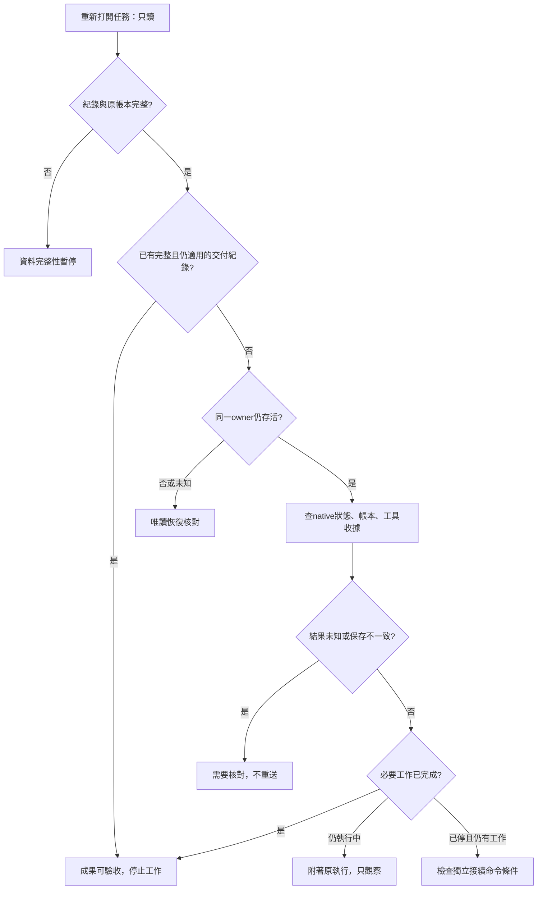

# 單任務安全重開契約（公開研究摘要）

研究查核：2026-10-26 夜至 2026-10-27（Asia/Taipei）；公開摘要：2026-10-27，版本 0.0.1。**本次更新只公開研究文件，不新增產品程式、正式 host／UI、服務或模型呼叫。** OpenCode 維持主選、Pi 對照，明確模型 profile；既有產品方向與 0.0.0 的 35/35 離線證據沿用，不重做選型總結。

本稿由私人研究材料衍生，保留分析、限制與固定官方來源；私人原稿保留，不公開其位置、執行識別或逐筆索引。公開摘要不是完整 trace，也不是新的測試結果。

## 本次決策建議

**把「重新打開工作」定義為觀察操作，與「繼續執行」分成不同命令。** 第一個可實作範圍建議限定為：連回仍存活的同一 host，或閱讀已完成成果。Host 已死、模型／工具結果未知、帳本遺失或結果未保存時，只呈現核對狀態，不自動建立 runtime 或繼續工作。

這是建議的下一階段範圍，尚未獲正式工程授權。它沒有解決所有 crash recovery；選擇保守停止正是目前 API 與證據能支持的界線。Pi 沒有因此自動勝出：兩套都缺 Calcifer 任務／帳本綁定、遠端 UNKNOWN 結算與完整跨層提交證據。

交付材料：[原生 API 對照](native-reopen-api-map-2026-10-27.md)、[8個合成契約案例](safe-reopen-cases-2026-10-27.json)、[本次證據摘要](safe-reopen-evidence-2026-10-27.json)、[C1–C8 證據映射](safe-reopen-evidence-map-2026-10-27.md)／[機讀摘要](safe-reopen-evidence-map-2026-10-27.json)。案例是未執行的設計材料，不是新的測試通過結果。

## 1. 三種權威不能互相替代

| 要回答的問題 | 權威資料 | 不足以替代的訊號 |
|---|---|---|
| 已送出幾次、預留多少、是否有未結算模型請求 | 原路徑、原run的RequestGuard帳本 | UI訊息數、native idle、切換session或新空帳本 |
| 模型回覆／工具呼叫在harness中保存到哪裡 | 對應版本的原生持久session與可用原生日誌 | SSE收到DONE、event listener收到message_end、RPC回覆success |
| 工具副作用是否發生、是否已核對 | 該operation的可信結果／收據；現有僅合成ReceiptLedger | 模型說成功、工具throw、模型請求已completed |
| 任務是否滿足完成條件 | 綁定當前workspace與範圍的驗證證據＋任務完成條件 | 模型stop、harness settled、無待批准項目 |
| 使用者是否接受、是否允許下一個操作 | 明確接受／批准紀錄及原授權範圍 | 畫面開啟、重新連線、上一個permission ID |

已驗證的本機mock只支持其測試範圍。真實selfhost遠端狀態仍須以當時已授權、已核對的服務契約為準；本文件不發明 `GET /requests/:id`、遠端取消或冪等API。[G1][G2][G3][T2]

## 2. 既有guard的精確語意與缺口

| 既有程式行為 | 本契約的使用方式 | 尚缺的host能力 |
|---|---|---|
| `events()`在ENOENT時回傳空陣列；首筆run會核對runID與policyHash | 已存在任務的預期帳本遺失時，先判資料缺口；不得直接呼叫dispatch當新run | 持久且不可任意換址的task→ledger/run綁定、存在性及身分檢查 |
| `state().unknown`＝沒有completed的所有intent | 它也包含仍在執行的請求。唯有同owner可信地確認仍active，畫面才可顯示「進行中」；不能由這欄直接推論遠端已失聯 | 單一owner與native活動狀態的關聯；舊PID或逾時本身不夠 |
| intent先append＋fsync，之後才進一次受控transport | 未有可信terminal就保留原intent、預算與UNKNOWN，不重送 | 真實網路所有出口與工具執行必須確實受gate控制；目前只驗mock路徑 |
| 完整SSE驗證後先append completed，然後把buffered response交SDK | completed只證明本adapter接受了模型terminal；不證明SDK已持久保存答案或工具結果 | model intent→native result的可核對關聯與保存狀態 |
| `headers`記可選x-request-id／x-service-version；intent ID由本地產生 | 保留既有ID供核對，不把本地ID當遠端冪等key | guard沒有把該intent ID傳給transport作遠端查詢識別；沒有remote reconcile入口 |
| 同帳本UNKNOWN、budget、時間窗及殘留lock會拒送 | 不刪鎖、不改runID／路徑、不開新模型或profile繞過 | 遺失帳本或另選新路徑不在guard自身保護範圍；host必須守綁定 |
| `ReceiptLedger.reconcile`只讀合成receipt並標acknowledged | 只能沿用到既有固定合成案例；不能當任意外部工具的結算協議 | 實際工具的operation→效果／收據核對、權限及持久性契約 |

上述前三個新缺口來自原碼查核，不是這輪故障注入結果。特別是**completed落盤後、SDK保存回覆前的crash窗口**：現有guard不存完整response，重開時可能知道推論結束卻沒有可交付答案；不能由usage重建、宣告完成或無聲再生成。[G1:12–29,58–79][G2:164–171][G4:63–68]

## 3. 最小host紀錄（新增欄位全部是提案）

以下是單任務紀錄需求，不是通用策略引擎／新資料平台。原生transcript仍由harness保存；host只保留身分、範圍、狀態來源與必要證據引用。秘密只引用安全取得位置，不存值。

| 提案欄位 | 內容／來源 | 重開時的規則 |
|---|---|---|
| `task.id`, `recordVersion` | Calcifer任務身分及紀錄版本 | 重新開啟不換task ID；辨識舊畫面的過期操作 |
| `workspace.ref`, `baseline`, `allowedScope` | 已確認repo、起始HEAD／dirty摘要及可操作範圍 | 外部變更不自行回復；原驗證不適用時標過期並指明差異 |
| `profile.ref`, `profileHash`, `harnessVersion` | 已批准的精確模型／provider／adapter／工具設定 | 不因重新開啟換profile或升級；模型切換是另一個有授權的動作 |
| `authorization.ref`, `acceptance.ref` | 任務授權、完成條件、驗證適用範圍 | 生成額度不等於實測窗口；重開不能擴張授權 |
| `native.sessionRef`, `native.storageRef` | OpenCode sessionID與指定DB；或Pi既有session file身分 | 不能用最新session／新session替代原身分；不向瀏覽器暴露秘密路徑 |
| `owner.instance`, `ownerObservation` | 目前唯一執行owner及觀察時間／來源 | 活著就附著同owner；未知就不建立第二個writer。跨process ownership尚未實作 |
| `ledger.ref`, `runID`, `policyHash` | 原始帳本固定位置／身分；既有guard欄位 | 預期存在卻遺失、損壞、身分不符都保守停止；不能以空帳本重置 |
| `requests[].intentRef`, `remoteRequestRef` | guard intent及可選response header ID | 不自造遠端query API；ID缺失原樣保留 |
| `requests[].nativeProjectionRef` | 對應native結果的身分／保存證據 | **目前未建立可靠跨層關聯**；unknown不補猜，缺失則result-projection-gap |
| `operations[].ref`, `receiptRef`, `status` | 各工具副作用operation與可信收據 | 與模型請求帳本分開；工具結算不能清除模型UNKNOWN |
| `pendingActions[].nativeRef`, `ownerInstance`, `scope` | 當前runtime重新查得的permission／form，或host自己的明確批准 | 不是通用持久批准。舊runtime的待辦過期；不重播舊approve／deny |
| `view.cursor`, `view.freshness` | OpenCode durable log sequence（條件成立時）；Pi可另存transcript entry ID與leafId，本次live連線投影版本分開 | Pi有`get_entries({since})`的持久entry游標，但沒有runtime event replay。UI最後看到的事件不作執行判定 |
| `delivery.evidenceRefs`, `verifiedFor`, `accepted` | 成果與適用workspace／版本、人工接受 | 證據足夠且未變就重用；已滿足驗收不再模型生成／額外測試 |

RequestGuard現有policyHash只綁定固定預算政策，**不是profileHash或授權hash**。Guard也不驗repo或native session身分；不能將上表當成現有程式已提供的欄位。[G1][G4]

## 4. 重開的順序與安全條件

1. **只讀host紀錄與指定帳本。** 核對task、workspace、profile、原native身分及資料完整性。此步不得呼叫prompt、resume、create、新建session或批准API。已知任務帳本缺失→資料完整性暫停。
2. **辨識原owner。** 仍存活且身分可核對，連回既有runtime；原owner未知或已死，先顯示上次checkpoint及時間，不以啟動runtime測健康。若已有完整交付紀錄且成果／證據仍適用，可只讀展示與接受成果，execution gate仍關閉，不需要重建runtime。OpenCode `OpenCode.create`可能自動恢復；Pi `SessionManager.open`不是對遺失／空檔的嚴格唯讀操作。[O1][P1]
3. **讀回權威狀態與必要事件。** 既有runtime的查詢可用，但多個get不是原子snapshot。觀察中狀態變動或跨不同owner，保留stale／不確定，不宣告全部settled。OpenCode日誌必須確認當時已開啟persist；Pi可補transcript entries，但不能要求不存在的runtime event replay。OpenCode permission／form讀取可能初始化instance／plugins，必須先確定該受控instance及gate條件；不是所有GET都保證零初始化副作用。
4. **分開核對模型、工具與native結果保存。** 任一UNKNOWN、投影缺口或狀態不一致都不啟用接續。僅UI斷線且owner仍執行→觀察；native idle不清除remote UNKNOWN。
5. **檢查完成條件。** 已有充分適用證據、結果完整、無待處理工作或未知副作用→可驗收，開啟畫面不再做任何工作。
6. **只有確定尚有工作，才考慮獨立接續命令。** 同一task／run／profile，原授權與窗口仍有效、預算未耗盡、工具與模型均已結算、native結果可讀、owner唯一，才可在真正dispatch邊界重新核對並接續。這是目標契約，尚無production host實作。

未完成資料核對前，畫面上的「繼續」不能僅憑上次按鈕狀態放行。若harness啟動本身就能恢復模型或工具，所有相應gate必須在其可能執行前有效；只在瀏覽器或prompt入口攔截不足。**完整啟動順序、工具replay與無session生成的覆蓋尚未驗證，不允許藉此啟動舊工作。**

## 5. 三條主要路徑與狀態轉移

| 路徑／觸發 | 權威判斷與下一步 | 禁止推論／操作 | 案例／依據 |
|---|---|---|---|
| 正常完成後重開 | 讀已保存結果；模型terminal、工具收據、native結果與任務證據都適用才可驗收 | 把`finish=tool_calls`、`length`或idle當任務完成；為安心再跑同版驗證 | C1；[G2][T2][O1][P1] |
| 只有UI／事件連線斷掉，原runtime仍活著 | 查同一runtime snapshot、重新訂閱並標freshness；若仍active只觀察 | 重送原prompt、換session、重建SDK、把斷線當遠端取消 | C2；[O1][P1] |
| 模型HTTP／SSE中斷、取消或沒有完整terminal | 原intent未completed；保持UNKNOWN與原預算，讀既有收據並列遠端核對缺口 | native idle／error就清UNKNOWN；換body／模型／帳本重試 | C3；[G1][G2][T1][T2] |
| 模型已terminal，工具效果未知 | 查該operation的可信收據／效果；現有合成T3只證明一次append＋clean reopen | 工具throw推定未執行；以工具receipt清除模型UNKNOWN | C4；[G3][G4][T2] |
| Host重啟、舊pending批准遺失 | 舊批准只作歷史；先核對啟動gate與新runtime當前pending | 重播舊permission ID、重送RPC prompt作查詢、把close當永久停止 | C5；[O1][P1] |
| Guard completed，但native答案未保存／無法關聯 | remote已知terminal與本地成果缺口分開；檢視既有存儲，保留缺口 | 從usage假造答案、宣告完成、無聲重生 | C6；[G1][G4][P1] |
| 已知任務的原帳本遺失 | 顯示缺資料，檢視保留副本；不呼叫會建新run的dispatch | `events=[]`＝從未發送或剩餘完整40次 | C7；[G1][T1] |

「停止等待」「stream drain」「工具停止」「remote inference terminal」保持獨立欄位；沒有證據就unknown。某模型結果terminal也不代表同一task後續所有工具及模型請求都已停止。[G2][T2]

## 6. 原生API使用規則摘要

精確方法、參數、欄位、事件及固定source行號在 [API對照](native-reopen-api-map-2026-10-27.md)。下表區分查詢與可能推進工作，**不是新增host已可呼叫的介面**。

| 行為 | OpenCode 2.1.4 | Pi 1.4.0 |
|---|---|---|
| 活host只讀snapshot | `client.session.get/active/context`、`client.session.inbox.list`；SDK有`sessions`別名。permission／form查詢另需受控instance條件 | RPC `get_state/get_messages/get_entries/get_tree`是getter；SDK以session／SessionManager讀回 |
| 事件重連 | `event.subscribe`無replay；`session.log(after,follow)`為experimental，且需先啟用`events.persist` | `get_entries({since})`可補持久transcript entries與leafId，但無runtime event replay；重綁subscription仍須處理read／subscribe間競態 |
| 啟動舊session | `OpenCode.create`沒有已確認的readOnly／disableRecovery公開選項；啟動會安排恢復 | `SessionManager.open`遇空／缺檔可寫入；`createAgentSession`還原狀態／載入資源，也不能當純reader |
| 送出／接續 | `session.prompt`即使相同id去重仍可能wake；`resume:false`是admission選項，不是SDK啟動開關 | RPC prompt acceptance不是durable admission；準備階段可能已做compaction；不可用重送作查詢 |
| 停止 | `interrupt`接受停止不等於cleanup結束；`resume:true`可再次推進，wait仍只到native idle | 清queue與abort是不同動作；`abort`不自動清queued steering/follow-up |
| 批准／拒絕 | `client.permission.*`及`client.session.form.*`；pending多為runtime記憶體。reject附message可能讓模型繼續，always可影響其他pending | RPC extension UI response是原process中pending request的回覆，沒有通用持久批准清單 |
| 完成通知 | idle／wait不是業務驗收；log水位不是所有狀態的原子提交 | `agent_end`不等於`agent_settled`；`message_end`先通知listener再append，不能當磁碟commit ack |

OpenCode的`outcome`描述最後完成execution，可能屬舊工作；`active()`僅觀察本程序drain。Pi本版`isStreaming`涵蓋整個run／postrun，同次get_state的`isStreaming=false`且`isCompacting=false`可對應當刻idle，但`pendingMessageCount`只計queued訊息，不計批准。兩者皆須核對本次工作身分與結果；不能由idle解除UNKNOWN。Pi SDK `session.waitForIdle()`會先檢查idle，`RpcClient.waitForIdle()`只等未來的settled事件，不能互換。[O1][P1]

## 7. 需要補齊才可擴到自動恢復的能力

| 缺口 | 現有證據能支持什麼 | 下一階段的最小驗收候選（尚未執行） |
|---|---|---|
| Task／ledger固定綁定與缺檔保護 | 同路徑同run的UNKNOWN與預算保留 | 已知任務帳本缺失、換址或損壞時零dispatch，不創新budget |
| Native啟動前的model＋tool gate | mock transport先於import安裝；固定SDK合成路徑拒送 | 舊execution復原前gate確實生效；禁止未結算工具replay，含內部續寫／壓縮等實際使用路徑 |
| 跨層結果保存關聯 | guard completed在SDK收到response前落盤；Pi message_end不代表保存完成 | 在這個窗口中斷後，能辨識結果缺口且不假成功／重送 |
| 重連snapshot與事件一致性 | 原生read/log接口存在；未驗協調 | 不漏待批准、不重播過期批准、不因重連重送；Pi沒有cursor時不偽造replay |
| 遠端UNKNOWN查詢／結算 | 現有guard沒有reconcile API；header requestID可為null | 先取得服務owner可驗證契約與授權，再定義terminal證據與結算方式；無契約就保持hold |
| 任意工具執行隔離／收據 | 只有合成ReceiptLedger與程序內fixture測試 | 固定工具範圍與可信operation收據，不把fixture loader當OS sandbox |

以上不是今晚要開工的清單，也不要求建新測試平台。若後續只批准活host重連，可先驗該流程；只有批准crash恢復才驗相關窗口，不把所有pending都變成眼前工程。

## 8. 證據分類、未決問題與停止點

- **已實測（沿用）**：固定版本35/35離線assertions、same-ledger拒送、完整SSE才交SDK、T3單次合成副作用與clean reopen、guard子程序退出後保守拒送。這些是 0.0.0 的歷史離線結果，本次沒有重跑；0.0.1 保持 17 個 source／test／fixture／profile 檔案不變，package 與 lockfile 只更新版本欄位，因此不宣稱原 19 項 hash 全部相同。
- **本輪原碼查核**：啟動／close／interrupt行為、pending批准生命週期、event cursor、RPC acceptance、message保存順序、guard缺檔與completed順序。API存在不是整合已通過。
- **本輪設計推論**：host欄位、重新開啟無副作用、缺帳本保護、projection gap、8案例的預期呈現。沒有實作或故障注入。
- **仍待確認**：使用者是否接受第一階段限活host重連／成果重開；controlled embedded host或既有server哪方持有全部gate；真實服務的結果查詢契約。未確認前保持研究提案，不切換選型、不開UI或服務。

本輪研究到這些路徑、欄位、API 證據與缺口可供決策即停止；本次只整理公開摘要與 patch 版本。完整 native crash／遠端 UNKNOWN 結算、真實模型品質、Spark 及人工接受仍 pending。八個完整 host 案例執行數為 0，新增測試、SDK/runtime 啟動與模型請求皆為 0。私人原稿及原始證據保留；公開包排除實際執行識別、原始訊息、完整 trace 與逐筆帳本索引。

## 證據索引

- **[G1]** [RequestGuard](../../src/request-guard.mjs)：12–29讀回／缺檔／unknown；31–58預算與intent；68–84回覆驗證、completed與unknown。固定公開程式版本 [58683dc](https://github.com/momonong/calcifer/blob/58683dc3ba6253f0cf7dedc6a1a43ef121842d6a/src/request-guard.mjs#L12-L29)。
- **[G2]** [selfhost response契約](../../src/selfhost-contract.mjs)：114–171，尤其164–171完整terminal與buffered response；只支持已固定的mock契約。
- **[G3]** [ReceiptLedger](../../src/receipts.mjs)：4–5合成限制；12–34 operation／effect／receipt與reconcile。
- **[G4]** [SDK worker](../../src/worker.mjs)：40–71先安裝mock出口；170–206 Pi clean reopen；214–240 OpenCode設定；282–296 OpenCode clean reopen。內部寫作「Read-only status check」的prompt其實是有副作用風險的prompt，測試是刻意驗gate拒送，**不得複製為產品的唯讀查詢實作**。
- **[T1]** [guard既有測試](../../test/request-guard.test.mjs)：13–22同路徑／改runID；24–41預算／窗口；43–64程序退出與取消。
- **[T2]** [SDK既有測試](../../test/selfhost-harness.test.mjs)：32–54不完整SSE、工具UNKNOWN、取消；56–79跨框架預算與24個合成request。
- **[O1]** [OpenCode固定版本API與原碼對照](native-reopen-api-map-2026-10-27.md#opencode)：產品2.1.4，`68bc26b7da1990ce10ffecfbc1e09eb13aa5d824`。
- **[P1]** [Pi固定版本API與原碼對照](native-reopen-api-map-2026-10-27.md#pi)：1.4.0，`4a080252f06caf63a525d7873c5d94d3c23887e0`。
